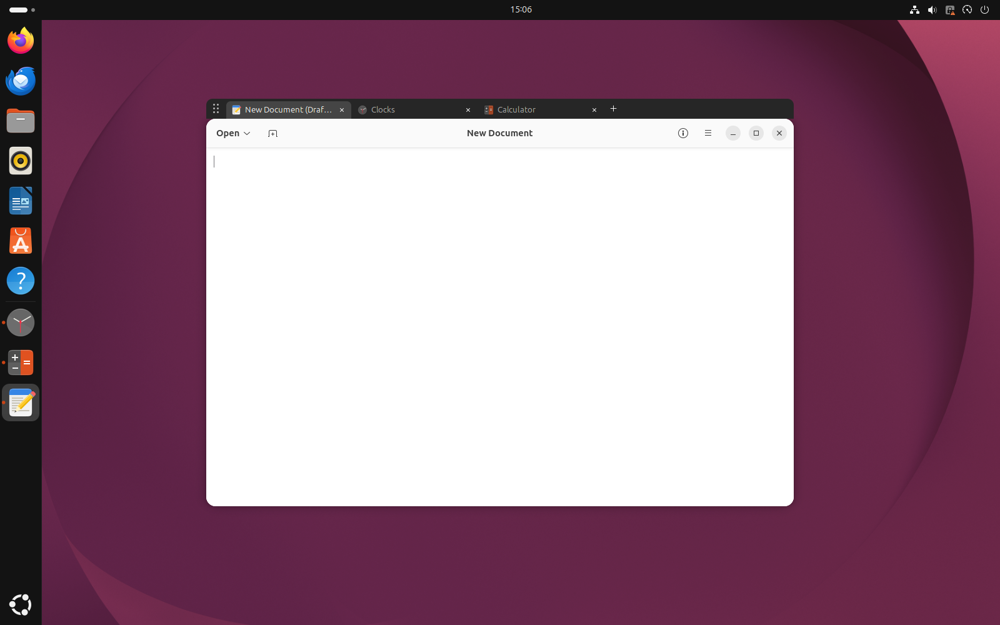
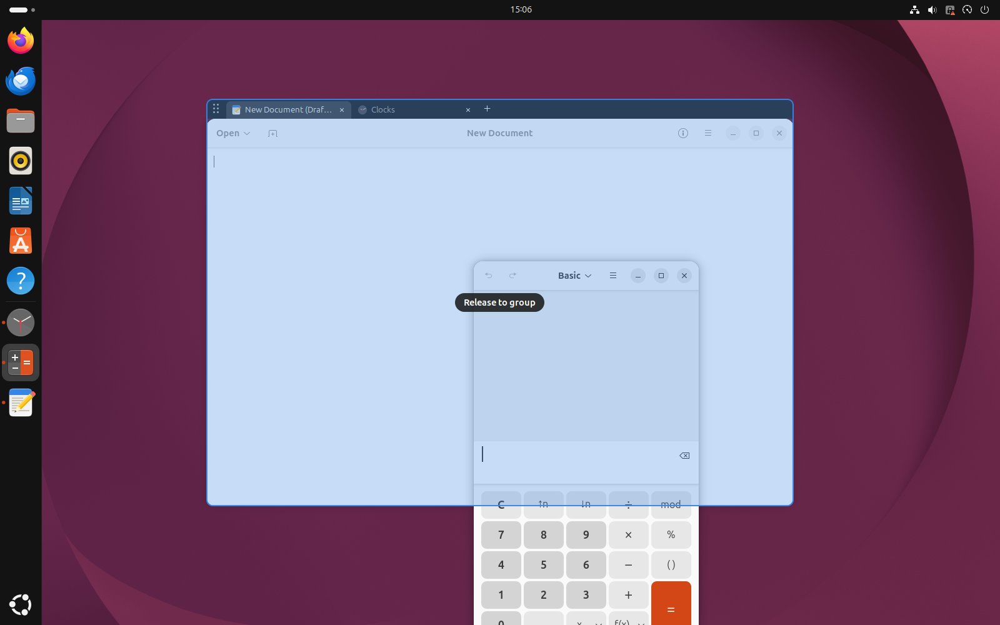
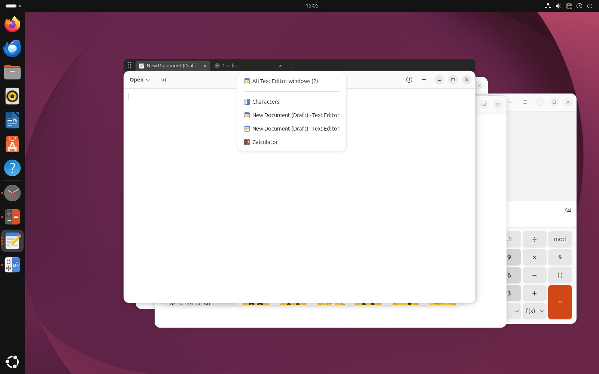
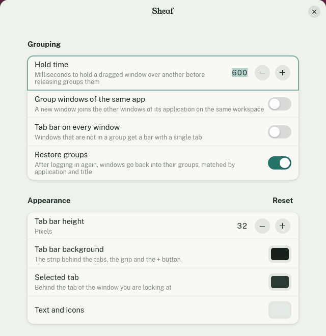

# Sheaf

*Part of the Sedge family of webhookstudios apps.*

Tab groups for any window on GNOME. Put windows from different applications into one slot with a tab bar, like browser tabs for your whole desktop.



## Requirements

- GNOME Shell 50 (Ubuntu 26.04)
- A Wayland session, which is the Ubuntu default

Sheaf has only been tested on Ubuntu 26.04 with GNOME Shell 50.1 on Wayland. Other GNOME versions are not marked as supported, and X11 is untested.

## Install

### With the deb package (recommended)

Download `sheaf_1.2.2_all.deb` from the [latest release](https://github.com/webhookstudios/sheaf/releases/latest), then install it:

```bash
sudo apt install ./sheaf_1.2.2_all.deb
```

Log out and back in, then open **Sheaf** from the apps menu. The first time, that turns Sheaf on and opens its settings. If you open it before logging out, it tells you to log out and turns itself on at the next login.

The package installs Sheaf for every user of the computer. To remove it:

```bash
sudo apt remove sheaf
```

### As an extension zip, without root

This installs the extension only, with no apps-menu entry. Download the latest zip and install it:

```bash
wget https://github.com/webhookstudios/sheaf/releases/latest/download/sheaf@webhookstudios.github.io.shell-extension.zip
```

```bash
gnome-extensions install --force sheaf@webhookstudios.github.io.shell-extension.zip
```

Log out and back in. GNOME on Wayland only notices a new extension when the session starts. Then turn it on:

```bash
gnome-extensions enable sheaf@webhookstudios.github.io
```

### From source

```bash
git clone https://github.com/webhookstudios/sheaf.git
```

```bash
./sheaf/install.sh
```

This installs for your user only, with the apps-menu entry. Log out and back in, then open **Sheaf** from the apps menu.

To remove a zip or source install:

```bash
gnome-extensions uninstall sheaf@webhookstudios.github.io
```

## Using it

### With the mouse

| To do this | Do this |
|---|---|
| Group two windows | Drag one window over another and hold it still for a moment. The window underneath is highlighted; release to group. |
| Add a window to an existing group | Drag it onto the group's tab bar and release. No wait needed. |
| Add windows from a list | Click **+** at the end of the tab bar and pick a window, or pick "All *App* windows" to add every ungrouped window of one application. |
| Switch tabs | Click a tab. |
| Move the whole group | Drag the grip at the left of the tab bar, or any empty part of the bar. |
| Reorder tabs | Drag a tab sideways. |
| Take a window out | Drag its tab up or down out of the bar. |
| Close a window | Click the × on its tab, or middle-click the tab. |





### With the keyboard

| Shortcut | Action |
|---|---|
| <kbd>Super</kbd>+<kbd>G</kbd> | Group the focused window with the window you used before it |
| <kbd>Super</kbd>+<kbd>Shift</kbd>+<kbd>G</kbd> | Take the focused window out of its group |
| <kbd>Super</kbd>+<kbd>]</kbd> | Next tab |
| <kbd>Super</kbd>+<kbd>[</kbd> | Previous tab |

All four can be changed in the preferences.

### What a group does

- Moving or resizing the visible window moves and resizes every tab.
- Maximizing a group fills the screen below the tab bar. Maximizing again restores its previous size.
- Minimizing the visible tab minimizes the group. Bringing any tab back brings the group back.
- Moving a tab to another workspace moves the group.
- Alt-Tab and the dock still list every window. Choosing a hidden tab there switches to it.

## Preferences

Open **Sheaf** from the apps menu, or run:

```bash
gnome-extensions prefs sheaf@webhookstudios.github.io
```



| Setting | Default | What it does |
|---|---|---|
| Hold time | 600 ms | How long a dragged window must be held still over another before releasing groups them |
| Group windows of the same app | Off | A new window joins the other windows of its application on the same workspace |
| Tab bar on every window | Off | Windows that are not in a group get a bar with a single tab |
| Restore groups | On | After logging in again, windows go back into their groups |
| Tab bar height | 32 px | Height of the bar above a group |
| Tab bar background | Dark pine | The strip behind the tabs, the grip and the + button |
| Selected tab, Text and icons | Pine, light gray | The tab you are looking at, and the titles and icons |
| Keyboard shortcuts | See above | Shortcuts already used by the desktop cannot be chosen |

The colors you pick are kept in your settings, not in Sheaf's files, so they stay through restarts and updates. **Reset** puts the bar height and colors back to the defaults. `test/colors.sh` checks this in a test shell: it picks a color, restarts, then updates from the previous package and checks that the bar keeps the color.

## Limitations

- **The tab bar sits above the window, not inside its title bar.** Applications draw their own title bars, and an extension cannot draw into them.
- **A group that fills the screen is not "maximized" to the application.** Its title-bar button keeps showing maximize rather than restore.
- **Edge-tiled groups are one bar-height shorter than their tile**, so the bar stays on screen. They will not line up exactly with a window tiled beside them.
- **Windows that cannot take the group's size** (fixed-size dialogs, windows with a large minimum size) will not match the group's rectangle. While hidden, the part that sticks out is invisible but can still catch a click, which switches to that tab.
- **Restoring groups is best effort.** Windows have no identity that survives a logout, so Sheaf matches them by application and title, falling back to application alone, for the first five minutes of a session. Two windows of the same app with changed titles can end up in each other's groups.
- **Maximized and fullscreen windows are never offered as a hold-to-group target**, because nearly every drag passes over one.
- Touch input is untested.

## How it works

Wayland does not let one program embed another program's window, so Sheaf fakes the group from inside GNOME Shell. A group is a list of windows that share one rectangle. Only the active one is visible; the others sit at the same rectangle with their window actor fully transparent. The tab bar is a Shell widget attached to the active window's actor, placed just above its frame, so it moves, stacks and minimizes with the window.

| File | Purpose |
|---|---|
| `extension.js` | Shortcuts, drag tracking, settings, saving and restoring groups |
| `group.js` | One group: membership, shared geometry, maximize and tiling corrections |
| `tabBar.js` | The tab bar widget and its pointer gestures |
| `hoverJoin.js` | Hold-to-group detection and the highlight |
| `addMenu.js` | The + menu |
| `prefs.js` | The preferences window |

## Development

`install.sh` copies the extension into place. To work on it without copying, link the source folder instead:

```bash
ln -s "$PWD/sheaf@webhookstudios.github.io" ~/.local/share/gnome-shell/extensions/
```

```bash
glib-compile-schemas sheaf@webhookstudios.github.io/schemas
```

A Wayland session cannot reload extension code, so each change needs a logout, or a separate test shell.

Build the release files into `dist/` with `./pack.sh` (extension zip) and `./build-deb.sh` (deb package, needs only `dpkg-deb`). The apps-menu entry, its icon and the launcher it runs are in `data/`.

## License

GPL-2.0-or-later. See [LICENSE](LICENSE).
